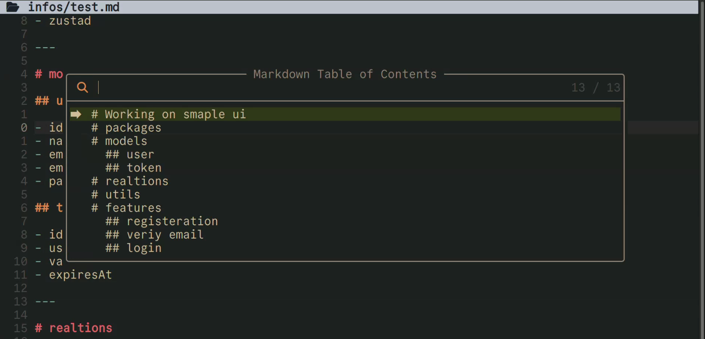

# markdown-toc.nvim

[](https://opensource.org/licenses/MIT)
[](https://github.com/sponsors/janecodelife)

A lightweight, high-performance, plugin to access markdown file headings (Table Of Content) with auto integrations with Telescope

## 🚀 Features

✅ Auto integrations with Telescope if installed and if not will use native vim.select

## 📦 Installation

```lua

vim.pack.add({
    "https://github.com/janecodelife/markdown-toc.nvim",
    "https://github.com/nvim-telescope/telescope.nvim" -- Optional
})

-- Setup and configure the plugin
require("markdown-toc").setup({
    min_level = 1, -- Include everything from level 1 (#)
    max_level = 6, -- Down to level 6 (######)
})

vim.keymap.set("n", "<leader>mo", "<cmd>MarkdownTOC<cr>", { desc = "Markdown Open TOC" })

```

## ⚙️ Configuration

| Option      | Type     | Default | Description                                                                  |
| :---------- | :------- | :------ | :--------------------------------------------------------------------------- |
| `min_level` | `number` | `1`     | The minimum markdown heading depth to parse into the table of contents list. |
| `max_level` | `number` | `6`     | The maximum markdown heading depth to parse into the table of contents list. |

---

## Video 📺

<p align="center">
  <a href="https://youtu.be/O9HuCR4MXR8">
    
  </a>
</p>

---

## 💝🤟 Support the Project 🤟💝

<p align="center">
  <a href="https://github.com/sponsors/janecodelife">
    
  </a>
</p>

Every bit of support fuels the expansion of this ecosystem and helps me write cleaner tools for all of us. Thank you for standing behind independent developers!_ 🙏🤟

---

## 💝🤟 A huge thank you to our sponsors! 💝🤟

<!-- SPONSORS -->
<!-- SPONSORS -->

---

## 🔗 My Other Plugins

Check out my other open-source tools to supercharge your Neovim environment:

- **[livewire-secure-properties](https://github.com/janecodelife/livewire-secure-properties)** - Secure livewire app properties by default and void headache.
- **[todo-tracker.nvim](https://github.com/janecodelife/todo-tracker.nvim)** - Assign and list app todos in a blink
- **[folders-bookmark.nvim](https://github.com/janecodelife/folders-bookmark.nvim)** - Bookmark folders and accessing them by keymap in a blink
- **[copy-history.nvim](https://github.com/janecodelife/copy-history.nvim)** - Access your copy (Yank) history and paste it again with support of edit by 1 click in a blink.
- **[rest-client.nvim](https://github.com/janecodelife/rest-client.nvim)** - run http request from anywhere in a blink
- **[smart-window-focus.nvim](https://github.com/janecodelife/smart-window-focus.nvim)** - resize split window on focus to be full size to easy to see and debug.
- **[markdown-toc.nvim](https://github.com/janecodelife/markdown-toc.nvim)** - access markdown file headings (Table Of Content)
- **[tiny-textobject.nvim](https://github.com/janecodelife/tiny-textobject.nvim)** - handle text objects (inner/around) without need for Tree-sitter.

---

## If Have A Question 🤝 (Contact Me) 🤟

I will be there to answer to all messages

- **X (Twitter)**: [https://x.com/janecodelife](https://x.com/janecodelife)
- **YouTube**: [https://www.youtube.com/@JaneCodeLife](https://www.youtube.com/@JaneCodeLife)
- **Email**: [janecodelife@gmail.com](janecodelife@gmail.com)

[](https://x.com/janecodelife)
[](https://www.youtube.com/@JaneCodeLife)

---

## Upcoming 🚀 (Stay Tuned!)

### The Ultimate Neovim Config for All Modern Web & Laravel Devs ⚡

# Thank You
